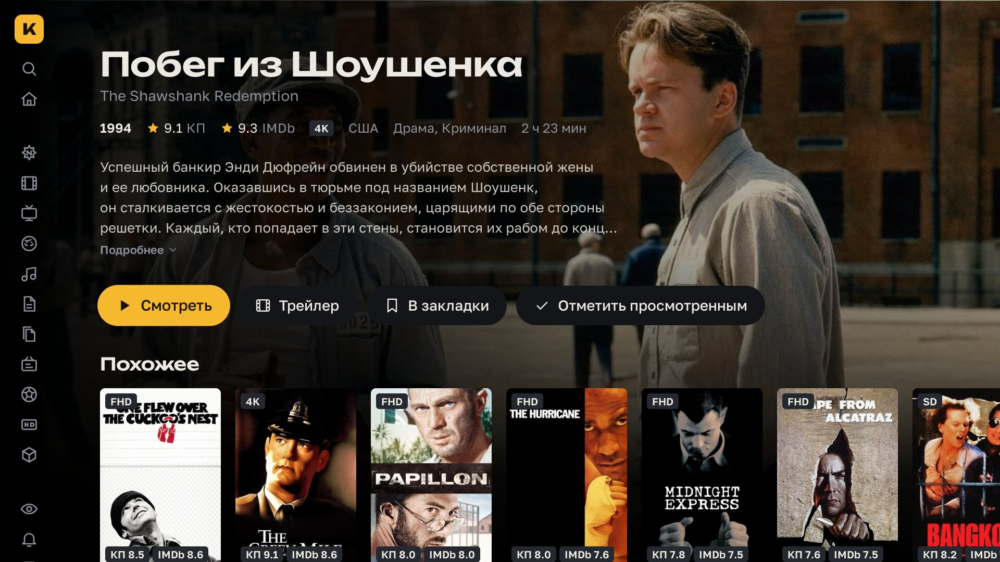
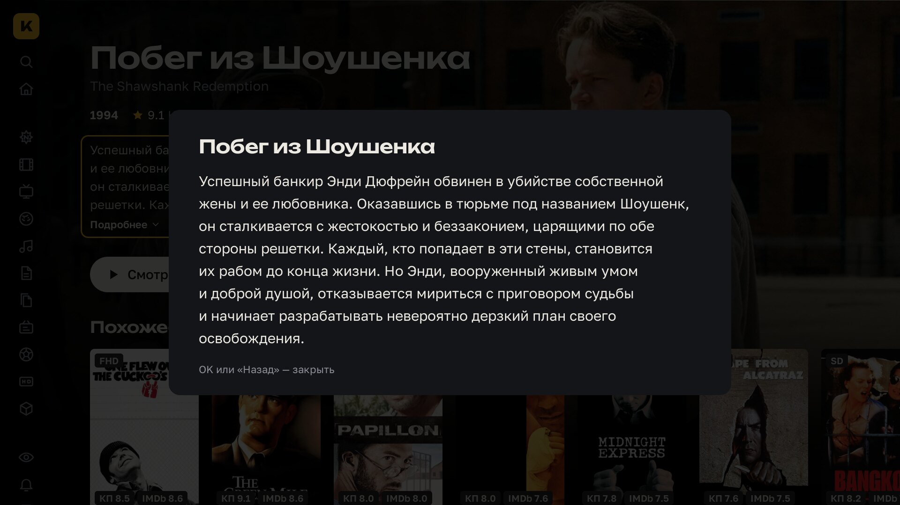
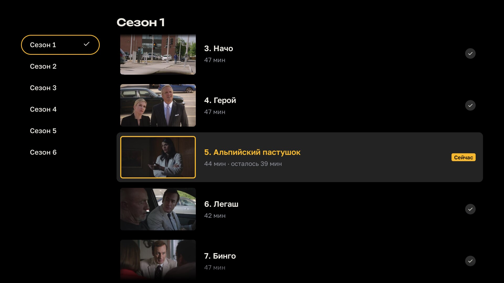
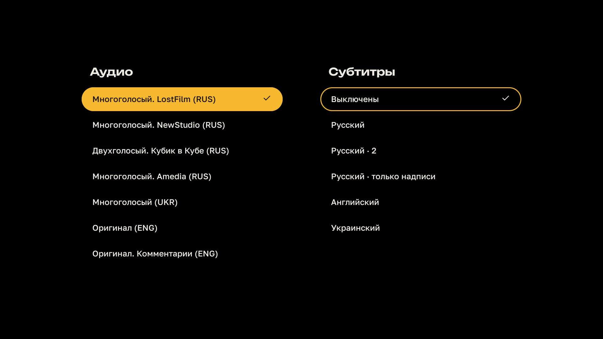

# Кинопаб TV

Неофициальный клиент [Кинопаба](https://kino.pub) для телевизоров LG на webOS. Навигация пультом, плеер на hls.js с переключением озвучки, субтитров и качества на лету, автозапуск следующей серии.

Нужна своя подписка на Кинопаб и телевизор на webOS 22 (2022) или новее: сборка рассчитана на Chromium 87 и новее. Проверено на LG OLED 2026 года (webOS 26, Chrome 132); на более старых прошивках не проверялось.


|                                                                            |                                                  |
| -------------------------------------------------------------------------- | ------------------------------------------------ |
|                        |     |
| Каталог: сортировка по рейтингу, фильтры по жанру, качеству, году и стране | Страница фильма с рейтингами КП и IMDb           |
|                            |     |
| Сериал: сезоны, серии с прогрессом просмотра                               | Полное описание, если оно не поместилось         |
|                            |  |
| Список серий прямо в плеере                                                | Озвучка и субтитры в одной панели                |

## Установка

Приложения нет в LG Content Store, поэтому телевизор нужно перевести в режим разработчика. Это бесплатно и делается один раз. Компьютер и телевизор должны быть в одной сети.

1. **Режим разработчика.** Зарегистрируйтесь на [developer.lge.com](https://webostv.developer.lge.com), установите на телевизор приложение **Developer Mode** из LG Content Store, войдите в нём в аккаунт LG и включите **Dev Mode Status**. Телевизор перезагрузится. Снова откройте Developer Mode, включите **Key Server** и запомните IP и passphrase с экрана.
2. **webOS Dev Manager.** Скачайте его из [релизов webosbrew](https://github.com/webosbrew/dev-manager-desktop/releases/latest) для Windows, macOS или Linux. Добавьте телевизор: IP и passphrase из первого шага.
3. **Приложение.** Скачайте `.ipk` из [последнего релиза](https://github.com/kaishien/kinopub-webos/releases/latest) и установите его в Dev Manager на вкладке **Apps**.
4. **Вход.** Откройте «Кинопаб» на телевизоре: он покажет адрес и код. Введите код на телефоне или компьютере и войдите в аккаунт Кинопаба.

Обновление — так же: скачать новый `.ipk` и установить поверх, вход и настройки сохранятся.

### Dev Manager на macOS

На macOS Dev Manager из Finder может не видеть телевизор («SSH Error: No route to host»), даже если в «Конфиденциальность и безопасность → Локальная сеть» он разрешён: программа подписана без сертификата Apple, и macOS не применяет к ней это разрешение. Запускайте её из Терминала, тогда она получит доступ к сети через Терминал:

```bash
nohup "/Applications/webOS Dev Manager.app/Contents/MacOS/webos-dev-manager" >/dev/null 2>&1 &
```

## Продление Developer Mode

LG выключает Developer Mode через 1000 часов, и приложения из него перестают запускаться. Таймер сбрасывается кнопкой продления в приложении Developer Mode на телевизоре: достаточно заходить туда раз в месяц.

Чтобы не помнить об этом, `scripts/renew-devmode.sh` сбрасывает таймер с компьютера, его удобно запускать по расписанию (cron, launchd). Нужен webOS CLI и ключ телевизора из раздела ниже.

```bash
cp scripts/tv.conf.example scripts/tv.conf     # впишите IP телевизора
cp ~/.ssh/tv_webos ~/.ssh/tv_webos_nopass
ssh-keygen -p -f ~/.ssh/tv_webos_nopass -N ''  # ключ без passphrase для запуска по расписанию
bash scripts/renew-devmode.sh                  # лог: ~/Library/Logs/webos-devmode-renew.log
```

## Разработка

### Windows, Linux и macOS (Electron)

Для настольной версии нужны Node.js 24 и pnpm 10. webOS CLI не требуется.

```bash
cd app
pnpm install --frozen-lockfile
pnpm desktop:dev          # Electron + Vite с обновлением интерфейса при изменениях
pnpm desktop:start        # собрать интерфейс и запустить локальную настольную версию
pnpm desktop:build:win    # Windows: установщик .exe
pnpm desktop:build:linux  # Linux: AppImage и .deb
pnpm desktop:build:mac    # macOS: .dmg и .zip
```

Собирать рекомендуется на соответствующей системе; macOS-сборку выполняйте на Mac.
`pnpm desktop:build` собирает пакеты для текущей системы, `pnpm desktop:pack` —
распакованное приложение для проверки. Результаты находятся в `app/release/`.
При первом запуске сборки потребуется интернет для загрузки Electron и инструментов упаковки.
Версия настольного пакета указана в `extraMetadata.version` файла `app/electron-builder.yml`.

Интерфейс сохраняет телевизионную компоновку 1920×1080 и автоматически масштабируется
под окно, с чёрными полями при другом соотношении сторон. Работают мышь,
стрелки, Enter и Backspace/Escape для возврата. F11 переключает полноэкранный режим;
на macOS также работает Ctrl+Cmd+F. Кнопка «Полный экран» в боковом меню и плеере
переключает всё окно Electron, скрывая панель задач Windows. Повторное нажатие
возвращает оконный режим.
В плеере кнопка «Пауза / Продолжить», пробел и клик по свободной области видео
переключают воспроизведение. Движение мыши показывает панель управления.
Качество, поток и серверы выбираются из раскрывающихся списков; логические параметры
управляются переключателями. Авторизация и настройки сохраняются в профиле
Electron между запусками; профиль разработки отличается от установленной версии.
Для просмотра нужна своя подписка Кинопаб. Поддержка аудио- и видеокодеков зависит
от Electron и системы, поэтому воспроизведение нужно проверять на целевой платформе.

В GitHub Actions доступен ручной workflow **Desktop builds**: он собирает приложение
на Windows, Linux и macOS и сохраняет установочные файлы как артефакты запуска.
Пакеты не подписаны: для публичного распространения подпись Windows и подпись/
нотаризацию macOS нужно настроить отдельно. Автообновление не добавлено.

`pnpm test:electron` проверяет масштабирование и ограничения навигации;
`pnpm check` включает эти тесты вместе с проверками основного приложения.

Настройки → **Прокси** доступны в настольной версии. До входа в аккаунт используется
кнопка **Настроить прокси** на экране кода устройства. Выберите системные настройки,
подключение без прокси или свой сервер HTTP/SOCKS5. Для своего сервера укажите
отдельно имя/IP и порт, без `http://` и пути. HTTP поддерживает логин и пароль;
SOCKS5 — без авторизации. Пароль сохраняется через защищённое хранилище системы
и не записывается открытым текстом. На Linux для этого нужно доступное системное
хранилище ключей; при его отсутствии доступны прокси без пароля.

Прокси применяется к удалённым запросам приложения, включая каталог, изображения
и видео, и восстанавливается при запуске. Локальные адреса компьютера обходят
прокси. После сохранения откройте видео или повторите запрос заново: уже открытые
сетевые соединения закрываются. Чтобы отключить прокси приложения, выберите
**Без прокси**; чтобы вернуть настройки Windows/macOS/Linux — **Системные настройки**.

Фильтры, списки и панели закрываются по клику на свободную область вокруг них.
В плеере курсор скрывается вместе с управлением после нескольких секунд без
движения; движение мыши снова показывает курсор и кнопки.

### webOS

Понадобятся Node.js 24, [pnpm](https://pnpm.io) и [webOS CLI](https://webostv.developer.lge.com/develop/tools/cli-installation): `npm i -g @webos-tools/cli`.

```bash
cd app
pnpm install
pnpm dev         # http://localhost:5173, стрелки и Enter вместо пульта, Backspace вместо «назад»
pnpm check       # tsc + oxlint + oxfmt --check + vitest
```

### Сборка и установка из исходников

Добавьте телевизор в webOS CLI под именем `tv` (Developer Mode и Key Server включены, как в разделе «Установка»):

```bash
ares-setup-device --add tv --info "{'host': '192.168.0.10', 'port': '9922', 'username': 'prisoner'}"
ares-novacom --device tv --getkey   # спросит passphrase с экрана телевизора
ares-device --device tv --system-info
```

```bash
bash scripts/package.sh                # только собрать build/ru.vrnn.kinopub_<версия>_all.ipk
bash scripts/deploy.sh                 # собрать, установить и запустить на телевизоре tv
bash scripts/deploy.sh --device=имя    # другое устройство из ares-setup-device
```

### Релиз

```bash
bash scripts/release.sh 1.4.12   # обновить версии, создать тег v1.4.12 и отправить в GitHub
```

По тегу `vX.Y.Z` GitHub Actions запускает проверки и собирает установщики для
Windows x64 (`.exe`) и Ubuntu amd64 (`.deb`), а также пакет webOS (`.ipk`).
Версия всех пакетов берётся из тега: `v1.4.12` даёт версию `1.4.12`, включая
Debian-пакет без суффикса `-1`. На Ubuntu пакет дополнительно устанавливается
в runner для проверки. После успешной сборки всех пакетов создаётся GitHub Release
с установщиками и файлом контрольных сумм `SHA256SUMS`. Повторный запуск workflow
обновляет вложения существующего релиза.

Можно также создать и отправить тег вручную после коммита изменений:

```bash
git tag v1.4.12
git push origin v1.4.12
```

Ручной workflow **Desktop builds** собирает Windows, Linux и macOS ARM64
(Apple Silicon), сохраняя результаты в артефактах Actions. Для него используется
версия из конфигурации проекта; GitHub Release он не создаёт. macOS-сборка пока
не подписана сертификатом Developer ID.

Отладка на телевизоре: `ares-inspect --device tv --app ru.vrnn.kinopub` выдаёт адрес DevTools.
